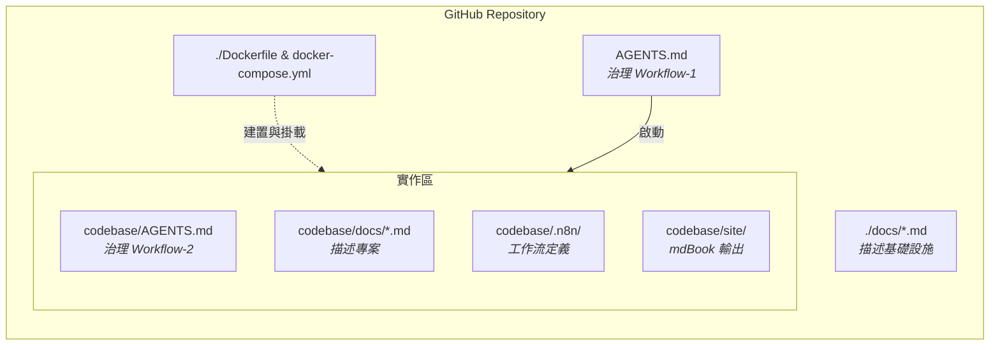
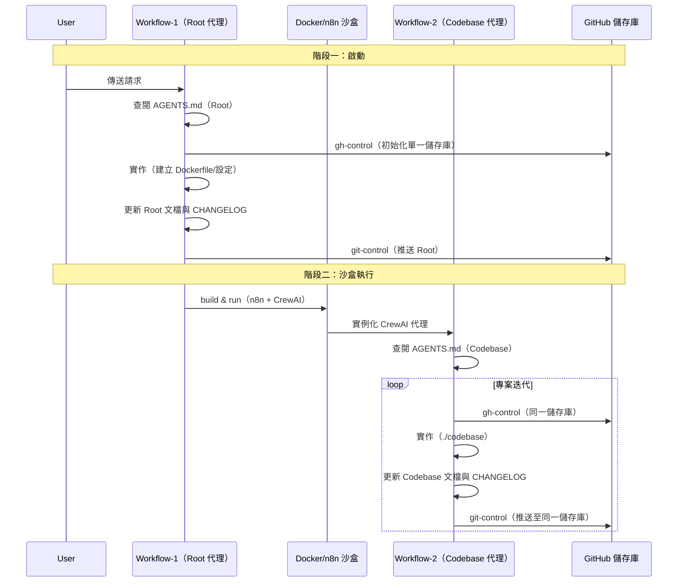

# AGENTS.md — Recursive Agentic Sandbox (RAS)

本專案為一套**遞迴代理沙盒（Recursive Agentic Sandbox, RAS）**：一個自我引導的開發環境，透過巢狀 AI 代理工作流自動化軟體專案的生命週期。系統採用「種子儲存庫」方式，由**主編排層（Workflow-1）**建置一個容器化的 n8n + CrewAI 沙盒，該沙盒再執行**次級實作層（Workflow-2）**以建置與維護特定專案。

> 本檔為 **Workflow-1（啟動階段）治理**。Workflow-2（專案階段）治理見 [`codebase/AGENTS.md`](codebase/AGENTS.md)。

## 架構框架

### 1. 結構階層

系統位於單一統合 GitHub 儲存庫，於**基礎設施（Root）**與**實作（Codebase）**之間進行邏輯分離。

### 2. 目錄結構矩陣

所有系統元件對映至特定治理工作流，以確保嚴格的稽核軌跡與文檔標準。

| 路徑 | 語境 | 工作流 | 用途 | 關鍵資產 |
| :--- | :--- | :--- | :--- | :--- |
| `./` | 統合 | **W1** | 系統編排 | `.env`, `docker-compose.yml`, `Dockerfile` |
| `./.git/` | 統合 | **W1 & W2** | 版本控制 | `.gitignores` |
| `./AGENTS.md` | Root | **W1** | **基礎設施治理** | Workflow-1 邏輯 |
| `./docs/` | Root | **W1** | 沙盒文檔 | `charter.md`, `srs.md`, `crm.md` |
| `./toc.md` | Root | **W1** | 根索引 | 根目錄樹 |
| `./CHANGELOG` | 統合 | **W1 & W2** | 統合稽核軌跡 | 全域版本歷史 |
| `codebase/` | 實作 | **W2** | 專案實作 | 原始碼與資產 |
| `codebase/AGENTS.md` | 實作 | **W2** | **專案治理** | Workflow-2 邏輯 |
| `codebase/.crewai/` | 實作 | **W2** | 建構代理 | `agents.yaml`, `tasks.yaml`, `config.yaml`, `tools/` |
| `codebase/.n8n/` | 實作 | **W2** | 工作流定義 | `hk-building-biography-workflow.json` |
| `codebase/site/` | 實作 | **W2** | 部署 | mdBook 輸出 → GH Pages |

> **`.crewai/` 的角色：** 存放**定義如何建置與維運 `codebase/`** 的代理設定（agents、tasks、tools、config）。由 Workflow-1 產出鷹架，供 n8n 沙盒於 Workflow-2 中呼叫執行，確保以良好方式建置 `codebase/`。

## 營運工作流

### Workflow-1：啟動階段

**治理：** `./AGENTS.md`
**目標：** 實例化基礎設施與容器化沙盒。
**執行路徑：**
`Request` → `AGENTS.md` → `gh-control` → `Implementation (./*)` → `Documentation (toc.md, docs/*.md)` → `CHANGELOG` → `git-control` → `gh-control`

### Workflow-2：專案階段

**治理：** `./codebase/AGENTS.md`
**目標：** 於 n8n/CrewAI 沙盒內執行專案特定迭代。
**執行路徑：**
`Crew AI Iterate` → `gh-control` → `Implementation (./codebase)` → `Documentation (codebase/docs/*.md)` → `CHANGELOG` → `git-control` → `gh-control`

> **`codebase/` 目的：** 提供一個可容器化 n8n 並執行由 Workflow-1 建置的 n8n 工作流的儲存庫，用以產生香港建築物導賞手冊。詳見 [`codebase/AGENTS.md`](codebase/AGENTS.md)。

## 技術實作

### 容器化沙盒（n8n + CrewAI）

系統透過 Dockerized 環境部署，融合 n8n 的編排能力與 CrewAI 的代理推理：

- **建置：** 自訂 Docker 映像，結合 n8n 執行環境與 Python 3.10+ 及所需 AI 函式庫。
- **執行：** `./codebase` 目錄綁定掛載至容器，確保沙盒內執行的代理將所有程式碼與文檔變更持久化至主機儲存庫。
- **編排：** n8n 作為觸發機制，依據傳入請求或排程事件呼叫 CrewAI 代理以執行 Workflow-2。

### 遞迴流程

## 硬性約束（Root 層）

- **分支流動固定：`dev-001 -> dev -> main`。** 每輪產出推送至 `dev-001`；GHA 流水線自動依序合併至 `main`。嚴禁直接推送至 `dev`／`main`。
- **提示詞工作流提交標題：** `feat(scaffolding): {簡述產出內容}`（清晰標題 + body）。僅 stage 該輪產出檔案。
- **CHANGELOG** 遵從語意化版本號（`major.minor.patch`）；每輪提示詞工作流追加一筆紀錄並依變更級別調升版號。
- **CrewAI 為強制要求。** 嚴禁以自定義手寫 Agent 取代。Crew 以 Python 腳本形式由 n8n 的 `Execute Command` 節點呼叫執行。
- **觸發器分離：** n8n 僅透過 Webhook／外部系統觸發啟動。Cron 排程屬於 GitHub Actions（`0 9 * * *` = HKT 17:00），**不在** n8n 中設定。
- **LLM 模型策略**（共用）：詳見 `codebase/AGENTS.md` 之「LLM 模型策略」章節，兩工作流共用同一組 `HKO_LLM_PRIMARY`／`HKO_LLM_FALLBACK`。

> 上述後三項（CrewAI 強制、觸發器分離、LLM 策略）為兩工作流**共用**的架構性約束；專案層（Workflow-2）的營運細節見 [`codebase/AGENTS.md`](codebase/AGENTS.md)。

## GitHub Actions（`.github/workflows/gh-pipeline.yml`）

單一統合流水線，為**基礎設施層級**（服務 W1 與 W2）：

- **自動分支推進：** push 至 `dev-001` 觸發依序合併 `dev-001 -> dev -> main`。
- **排程與手動觸發：** `workflow_dispatch` + cron `0 9 * * *`（HKT 17:00）；於 `main` 分支執行品質檢查與建置。
- **品質閘門 → 建置與部署：** 於 `main` 執行 CodeQL + SonarQube 掃描（要求零重大漏洞）；通過後於 `codebase/site/` 編譯 mdBook 並部署至 GitHub Pages。
- **PM 最終審查：** 流水線結束後同步 GitHub Project 看板與 Issue 狀態，確保全流程閉環。

## 文件引用鏈（Root 層）

- 根索引 → [`toc.md`](toc.md) → [`docs/*.md`](docs/)
- 專案內容 → [`DESCRIPTION`](DESCRIPTION), [`CHANGELOG`](CHANGELOG)
- CI/CD 管線 → [`.github/workflows/gh-pipeline.yml`](.github/workflows/gh-pipeline.yml)
- n8n 工作流程 → [`codebase/.n8n/hk-building-biography-workflow.json`](codebase/.n8n/hk-building-biography-workflow.json)
- 專案治理 → [`codebase/AGENTS.md`](codebase/AGENTS.md)